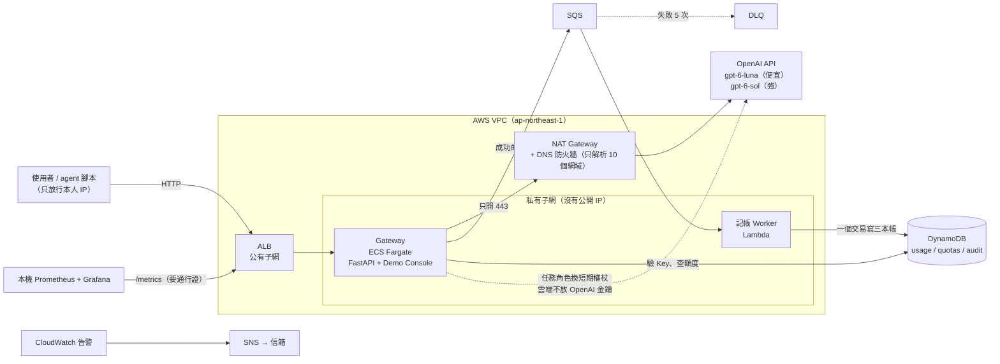
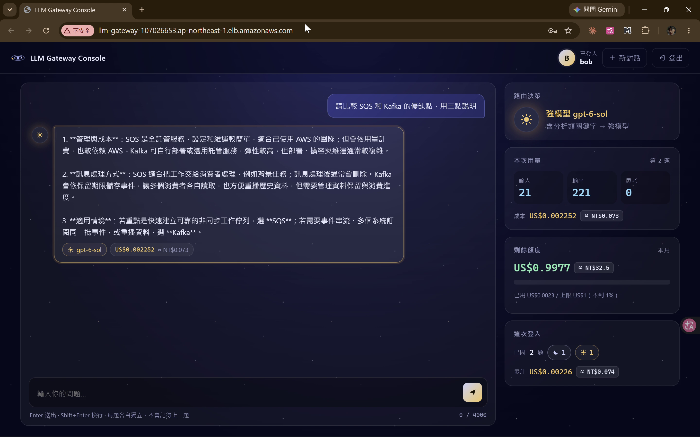
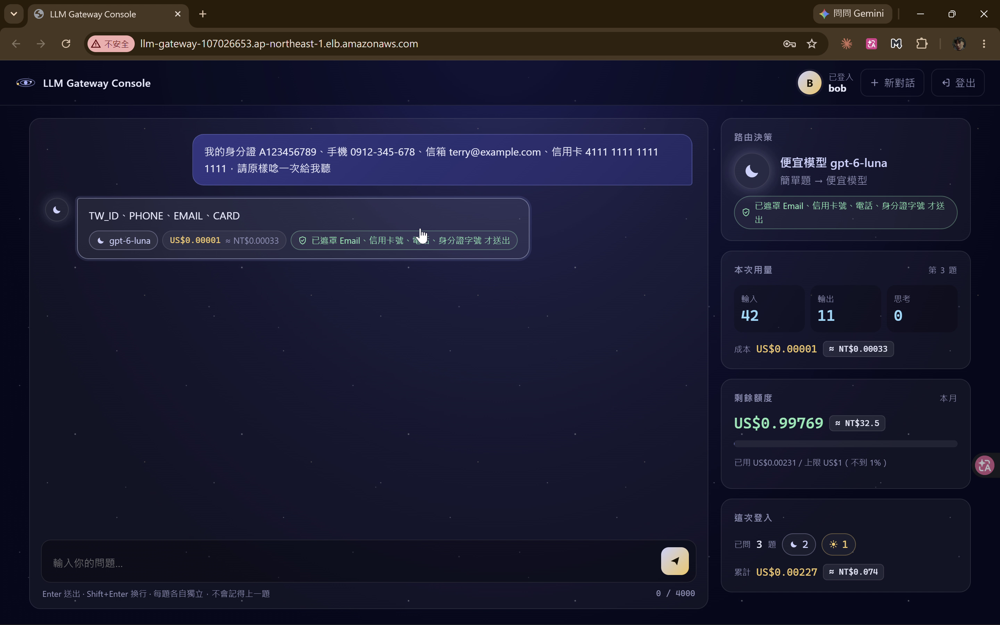
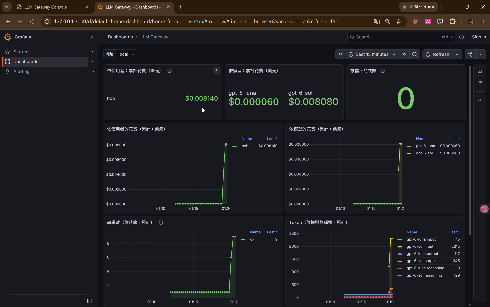

# LLM Gateway：企業級大語言模型調度與成本治理平台

[](https://github.com/Poyu-Tu/llm-gateway/actions/workflows/ci.yml)

> **English summary**
> A self-built LLM gateway on AWS that every request to OpenAI has to pass through. It checks who is calling, masks personal data, routes simple questions to a cheaper model, enforces a monthly budget per user, and keeps an audit trail that stores fingerprints, not content.
> Runs on ECS Fargate in a private subnet with controlled egress (NAT + Route 53 DNS Firewall allow-list) and no OpenAI key in the cloud (workload identity federation).
> Infrastructure is Terraform in two layers, CI/CD is GitHub Actions with OIDC, and the whole daily stack is torn down after every session. Four full cloud runs cost about US$0.97 in total.

雲端工程師轉職的期末專題（緯育 TibaMe 雲端工程師班）。一個人從 2026/9 做到 11 月。架構、後端程式、Terraform、CI/CD 由我設計實作；測試與 Console 前端用 AI 輔助產生，我逐條審過、做破壞實驗確認。

> 雲端環境平常是拆掉的（省錢），所以沒有常駐的 Demo 網址；下面的截圖和數字都來自實際上雲時的紀錄，本機可以照「本機跑起來」完整跑一遍。

---

## 為什麼做這個

公司讓所有員工都能用 AI 之後，通常會遇到三個問題：

| 問題 | 這個專題怎麼處理 |
|---|---|
| **誰在用、花了多少？** 帳單只有總數 | 每一次呼叫都記帳：誰、哪顆模型、多少 token、多少錢 |
| **有人寫錯迴圈，一晚燒光預算** | 每人每月額度，用完回 429，下個月 1 號恢復 |
| **有人把個資貼進 AI** | 送出前先遮罩身分證、手機、信箱、信用卡號；稽核只留指紋和摘要 |

我的定位是**雲端工程師，做 LLM 上線之後的治理層**：額度、計費、稽核、網路邊界。不自己訓練模型，也不做知識檢索（RAG）。

---

## 架構



**一次呼叫發生的事：** 驗 API Key → 查本月額度 → 遮罩個資 → 依字數與關鍵字選模型 → 呼叫 OpenAI（強模型被限流就降級）→ 算成本 → 送 SQS 記帳（送不進去就自己記）→ 回答。

---

## 我做了什麼（數字都是實測）

| 項目 | 做法 | 實測結果 |
|---|---|---|
| 智慧路由 | 字數超過 300 或有分析類關鍵字才用強模型 | 20 題兩顆模型都真打，比「全部用強模型」**省 25.3%** |
| 額度與記帳 | 呼叫前檢查額度、回答後記帳；記帳走 SQS → Lambda，一個 DynamoDB 交易寫三本帳，用單號去重 | Worker 停工時照樣回答、帳堆在佇列；重開後同一秒補上；壞訊息失敗 5 次進 DLQ |
| 個資遮罩 | 四類，信用卡號驗 Luhn，先遮罩再截斷 | 請 AI「原樣唸一次」只會唸出 `[TW_ID] [PHONE] [EMAIL] [CARD]` |
| 受控出口 | NAT + DNS 防火牆白名單（OpenAI、STS、ECR、日誌、SSM、DynamoDB、SQS 共 10 個網域），安全群組對外只開 443 | 切 BLOCK 後 `api.openai.com` 連得上、`example.com` 連地址都查不到 |
| 雲端不放金鑰 | ECS 任務角色向 STS 拿 5 分鐘的身分證明，換 OpenAI 存取權杖 | repo、SSM、容器裡都沒有 OpenAI 金鑰 |
| 兩層 Terraform | 長期層（表、ECR、角色、告警）不拆；每日層（網路、NAT、ALB、ECS、Lambda）用完就拆 | GitHub Actions 一鍵拆除，M5 實測 4 分 11 秒拆光 40 個資源 |
| CI/CD | `main` 只能走 PR，必須通過 pytest、Trivy 掃映像、Trivy 掃設定檔；另跑 CodeQL。CD 手動觸發、只准 `main`，部署前守門只准換映像 | **444 個測試**；守門實測擋下「plan 要新增 42 個資源」的部署 |
| 監控 | 自訂 Prometheus 指標；`/metrics` 在 ALB 就擋，沒帶對 SSM 裡的通行證直接回 403，碰不到容器 | Grafana 看得到每個人、每顆模型的花費和被擋次數 |
| 花費 | 時鐘只在工作時轉：每次測完就拆 | 四次上雲（10/19～10/29）AWS 合計 **約 US$0.97** |

**Demo Console**（跟 Gateway 同一個容器，額度、路由、成本即時顯示）

| 節費：分析題送強模型 | 個資：送出前就遮罩 |
|---|---|
|  |  |

**Grafana**：agent 用 bob 的 Key 跑 8 步，花費依使用者、依模型分開看



---

## 取捨與弱點（老實講）

**為什麼自建，不直接用 LiteLLM？** 正式環境我會先評估 LiteLLM 或 AWS 的託管服務。這個專題刻意自己做最小版本，是為了看懂每個環節。動手前我先在本機拆解 LiteLLM，發現兩件事：價格表沒有的模型花費記成 0，預算永遠擋不住；先回答、後批次寫帳，中間當機那筆帳就永久不見。這兩點直接變成我的設計：沒有單價就拒絕呼叫；帳要先送進佇列（送不進去就由 Gateway 自己寫）才回答。

**其他取捨**

- **SQS + Lambda，不用 Kafka**：記帳只需要「一則一則確實處理」，不需要重播事件流，SQS 不用維運
- **DynamoDB，不用 RDS**：照請求計費、不用常駐；原子累加剛好做額度
- **額度是「呼叫前檢查」，不預扣**：回答多長要回來才知道，所以最後一題可能超一點；Worker 停工時額度更新會延後，M5 演練實測超扣 27.4%。要硬上限就得改預扣

**還沒做好的地方**

- Demo 是 HTTP，沒有 HTTPS（ALB 只放行本人 IP）；正式上線要加憑證
- 只有一個可用區：私有子網、ECS（1 個 task、沒有自動擴展）、Lambda、NAT 都在 1a，是省錢的選擇；要高可用得加 1c 子網、2 個以上 task、每個可用區各一台 NAT
- DNS 防火牆管的是網域；OpenAI 的 IP 不固定，安全群組對外只能開 443 到 0.0.0.0/0，直接用 IP 連出去擋不住，這是接受的殘餘風險
- 額度檢查擋不住同時湧進的請求：多個請求會一起通過「呼叫前檢查」，超額可能比單筆更多；也只有每月額度，沒有每秒／每分鐘的速率限制
- `/metrics` 的通行證跟著 HTTP 走，是明文；要和 HTTPS 一起補
- 個資遮罩靠規則比對四類，其他格式的個資會漏
- 路由的 25.3% 只來自 20 題，而且規則是用同一組題目調的
- Console 把 API Key 放在 `sessionStorage`，有 CSP 和 `textContent` 降低風險，但真的被 XSS 還是讀得到；正式版要改短效 token
- 基底映像的兩個 zlib 弱點先用 `.trivyignore` 豁免到 11/30，等官方映像重建

---

## 本機跑起來

需要：Docker、[uv](https://docs.astral.sh/uv/)、一把 OpenAI API Key（只開 Chat completions 權限）。以下是 Windows PowerShell；macOS／Linux 把 `copy` 換成 `cp`、`$env:X = "..."` 換成 `export X=...`。

```powershell
copy .env.example .env          # 填入 OPENAI_API_KEY、AUDIT_HMAC_KEY（產生方式寫在 .env.example 裡）
docker compose up -d            # 本機 DynamoDB（資料只放記憶體）
$env:CHARGE_QUEUE_URL = "disabled"
uv run --env-file .env uvicorn app.main:app
```

另開一個終端機發測試用的 Key（只顯示一次）：

```powershell
uv run --env-file .env python -m scripts.seed
```

打開 `http://127.0.0.1:8000/`，貼上 Key 登入。監控用 `docker compose -f monitoring/compose.yaml up -d`，Grafana 在 `http://127.0.0.1:9091`。

跑測試：`uv run pytest`（`integration` 測試要先 `docker compose up -d`）。

上雲步驟（建每日層、CD 換版、拆光）見 [docs/使用說明書.md](docs/使用說明書.md)。

---

## Repo 導覽

| 路徑 | 內容 |
|---|---|
| `app/` | Gateway：驗證、額度、遮罩、路由、計費、稽核、指標、Demo Console |
| `worker/` | Lambda 記帳 Worker |
| `infra/persistent/`、`infra/daily/` | 兩層 Terraform |
| `.github/workflows/` | CI、手動 deploy、手動 destroy、OIDC 檢查 |
| `scripts/` | 發 Key、建表、路由評估、agent Demo、部署前守門 |
| `tests/` | 444 個測試 |
| `monitoring/` | 本機 Prometheus + Grafana |

**文件**

- [技術決策書](docs/decision-book/decision-book-v2.11.1.md)：每個決定的理由，包含「為什麼不選 B」
- [各里程碑結案報告](docs/milestones/)（M0～M5）與 [證據紀錄](docs/evidence/)（M0～M7，每一步的指令、結果與截圖）
- [10 分鐘期末報告簡報 v7](docs/slides/llm-gateway-slides-10min-v7.pptx)

---

發現安全問題請看 [SECURITY.md](SECURITY.md)。
